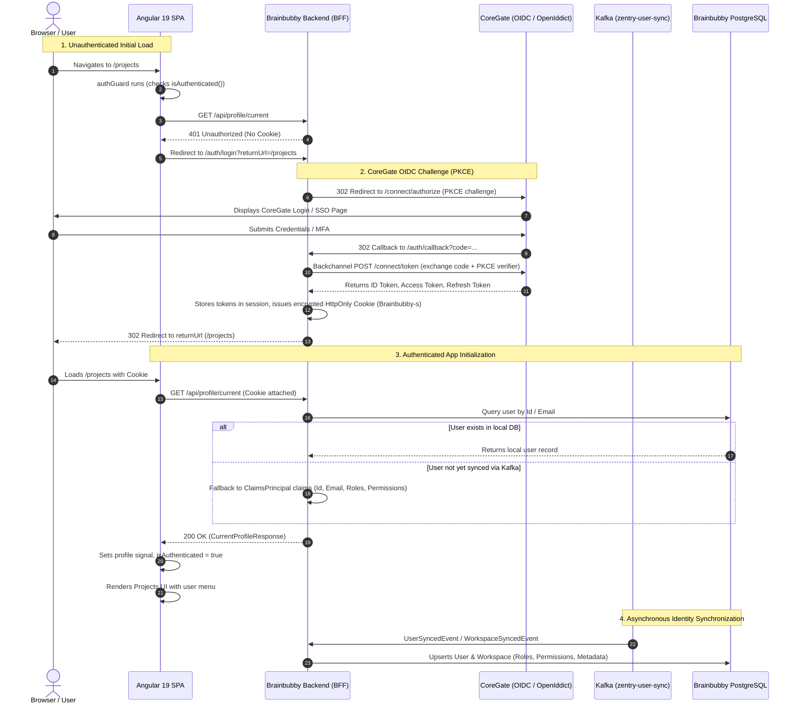

# Brainbubby Authentication & Authorization Architecture

This document describes the end-to-end authentication and authorization workflow for **Brainbubby**, integrated with **CoreGate** (OpenID Connect Identity Provider) and **Zentry** (Identity Management & Permissions), following the Backend-For-Frontend (BFF) security pattern.

---

## 1. High-Level Architecture (BFF Pattern)

Brainbubby uses the **Backend-For-Frontend (BFF)** pattern:

- The Angular SPA does **not** store raw access tokens or refresh tokens in `localStorage` or `sessionStorage` (preventing XSS token leakage).
- All authentication sessions are held via an encrypted, `HttpOnly`, `SameSite=Strict`, `Secure` cookie (`Brainbubby-s`) issued and managed by the ASP.NET Core backend.
- The ASP.NET Core backend interacts with **CoreGate** (OIDC IdP) via PKCE authorization code grant.
- **Machine-to-Machine (M2M)** / CLI / Daemon workers authenticate directly via OAuth2 `client_credentials` grant with a Bearer token validated by OpenIddict.



---

## 2. Authentication Flow Details

### A. Frontend (Angular 19)

1. **`authGuard`** (`src/features/auth/auth.guard.ts`):
   - Implemented as a modern functional route guard using Angular's **`CanActivateFn`** (`(route, state) => Observable<boolean> | boolean`).
   - Attached to protected routes in `app.routes.ts` via `canActivate: [authGuard]` (`/projects`, etc.).
   - Inspects `authService.isAuthenticated()`:
     - If `true`, returns `true` immediately to allow navigation.
     - Otherwise, calls `authService.loadCurrentProfile()`. If profile loading succeeds, navigation proceeds; if it fails, invokes `authService.redirectToLogin(state.url)` and returns `false`.

2. **`authInterceptor`** (`src/features/auth/auth.interceptor.ts`):
   - Implemented as a functional HTTP interceptor using Angular's **`HttpInterceptorFn`** (`(req, next) => Observable<HttpEvent<unknown>>`).
   - Registered in `app.config.ts` via `provideHttpClient(withFetch(), withInterceptors([authInterceptor]))`.
   - Intercepts all outgoing HTTP requests across the application:
     - Detects `HttpErrorResponse` with status `401 Unauthorized`.
     - Excludes `/api/profile/current` (to prevent duplicate redirects during profile checks).
     - For any other protected endpoint returning 401, calls `authService.redirectToLogin()` with the current URL.

3. **`authService`** (`src/features/auth/auth.service.ts`):
   - `profile`: Signal holding the current user profile, roles, and permissions.
   - `isAuthenticated`: Signal derived from profile state.
   - `redirectToLogin(returnUrl)`: Redirects browser to `/auth/login?returnUrl=...`.
   - `logout()`: Redirects browser to `/auth/logout?returnUrl=/`.

### B. Backend BFF (`OpenSaur.Brainbubby.Web`)

1. **`/auth/login`** (`Features/Auth/Login/LoginHandler.cs`):

   - If user is already authenticated via cookie, redirects to `returnUrl`.
   - Otherwise, challenges `AuthConstants.DefaultOidcScheme`, redirecting to CoreGate with PKCE parameters.
2. **`/auth/callback`** (OIDC Middleware):

   - Handled automatically by `Microsoft.AspNetCore.Authentication.OpenIdConnect`.
   - Validates authorization code, exchanges it with CoreGate's token endpoint over backchannel HTTP.
   - Creates `ClaimsPrincipal` populated with user claims (`sub`, `email`, `role`, `permissions`, `workspace_id`).
   - Writes encrypted `Brainbubby-s` session cookie with sliding expiration.
3. **`/auth/logout`** (`Features/Auth/Logout/LogoutHandler.cs`):

   - Signs out of local cookie scheme (`Brainbubby-s`).
   - Signs out of CoreGate via OIDC end-session endpoint to ensure Single Sign-Out.
4. **Token Refresh** (`Features/Auth/Refresh/AuthTokenRefreshCookieEvents.cs`):

   - Intercepts cookie validation on incoming requests.
   - If the access token is near expiration, uses the stored reference refresh token to silently refresh against CoreGate and updates the cookie.

---

## 3. Profile & Identity Retrieval (`/api/profile/current`)

- **Handler**: `Features/Profile/Profile/Handlers/CurrentProfileHandler.cs`
- **User Context Extraction**: `IClaimService.GetUserContext(ClaimsPrincipal)` extracts `UserId`, `Email`, `WorkspaceId`, `IsSuperAdministrator`, `Roles`, and `Permissions`.
- **Database Resolution**:
  - Queries `BrainbubbyDbContext.Users`.
  - **Graceful Fallback**: If the user record has not yet been synced to `Users` table via Kafka, the endpoint synthesizes a valid `CurrentProfileResponse` directly from the OIDC claims. This prevents 404 redirect loops on fresh databases or new user registrations.

---

## 4. Authorization & Permissions

### A. Permission Scopes & Codes in Zentry (`IdentityDb`)

Brainbubby permissions belong to the `Brainbubby` permission scope in Zentry:


| Permission Code      | Display Name | Rank | Scope        | Description                                                                     |
| ---------------------- | -------------- | ------ | -------------- | --------------------------------------------------------------------------------- |
| `Brainbubby.CanView` | **Can View** | 1    | `Brainbubby` | Read-only access to inspect projects, rules, and files                          |
| `Brainbubby.CanEdit` | **Can Edit** | 2    | `Brainbubby` | Full permission to create, update, manage projects, rules, snapshots, and files |

### B. Backend Authorization Evaluation

- **Constants**: `AuthConstants.Permissions.CanEdit` and `AuthConstants.Permissions.CanView`.
- **SuperAdministrator Bypass**: Users with the `SuperAdministrator` role bypass granular project permission restrictions.
- **Resource-Level Authorization**:
  - Project read access requires `CreatorId == CurrentUserId`, an active entry in `ProjectUserPermissions`, or `SuperAdministrator`.
  - Project mutation (edit/delete/add members) requires `Brainbubby.CanEdit` or project ownership.

---

## 5. Machine-to-Machine (M2M) Authentication

For automated workers, CLI tools, MCP clients, and background daemons:

1. Register a **Confidential Client** in CoreGate/Zentry with `grant_type: client_credentials` and scope `api`.
2. Daemon requests access token directly from CoreGate:
   ```http
   POST https://coregate.duchihao.com/connect/token
   Content-Type: application/x-www-form-urlencoded

   grant_type=client_credentials&client_id=<client-id>&client_secret=<secret>&scope=api
   ```
3. Daemon attaches token as Bearer in API calls to Brainbubby:
   ```http
   GET /api/projects
   Authorization: Bearer <access_token>
   ```
4. Brainbubby's `AddOpenIddict().AddValidation(...)` validates the JWT token against CoreGate's public keys without needing any session cookie.
